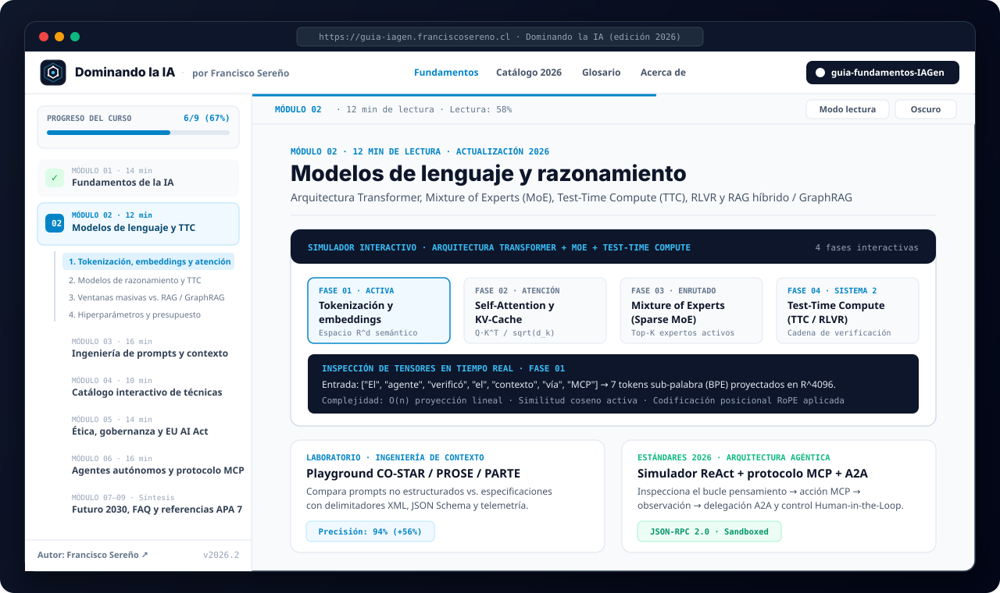
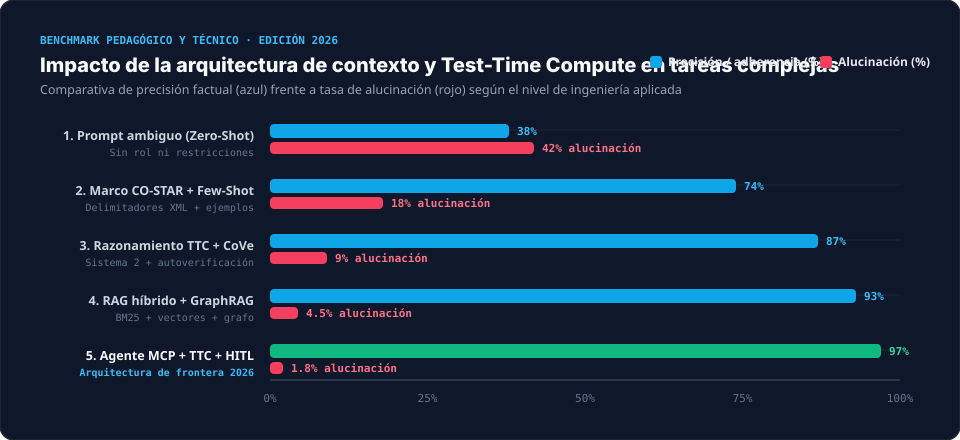
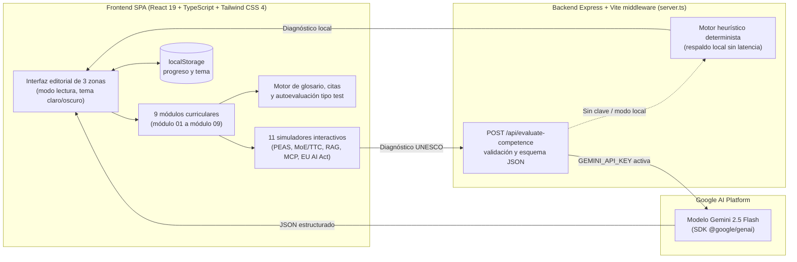
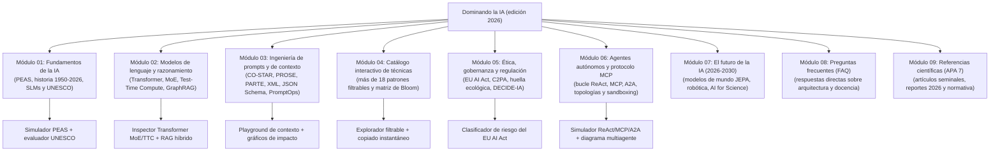
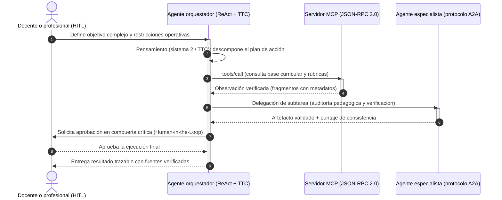

<div align="center">


# Dominando la IA: guía interactiva de fundamentos, razonamiento y agentes autónomos

**Plataforma educativa abierta y laboratorio técnico sobre inteligencia artificial generativa, modelos de razonamiento (*Test-Time Compute*), ingeniería de contexto, gobernanza ética (EU AI Act) y arquitecturas agénticas (MCP y A2A) — edición 2026**

[](https://github.com/francisco-sereno/guia-fundamentos-IAGen)
[](https://portafolio.franciscosereno.cl/sobre-mi)
[](https://www.linkedin.com/in/franciscosereno/)
[](#estructura-detallada-de-módulos-y-laboratorios)
[](https://creativecommons.org/licenses/by-nc-sa/4.0/deed.es)


</div>

---

## 📑 Índice de contenidos

1. [Pantallazo de la aplicación y anatomía visual](#-pantallazo-de-la-aplicación-y-anatomía-visual)
2. [Descripción general y propuesta de valor](#-descripción-general-y-propuesta-de-valor)
3. [Características principales y simuladores interactivos](#-características-principales-y-simuladores-interactivos)
4. [Gráfico de impacto: ingeniería de contexto y razonamiento](#-gráfico-de-impacto-ingeniería-de-contexto-y-razonamiento)
5. [Esquemas de arquitectura y flujos del sistema](#-esquemas-de-arquitectura-y-flujos-del-sistema)
6. [Estructura detallada de módulos y laboratorios](#-estructura-detallada-de-módulos-y-laboratorios)
7. [Tablas técnicas de referencia rápida](#-tablas-técnicas-de-referencia-rápida)
8. [Stack tecnológico y estructura del proyecto](#-stack-tecnológico-y-estructura-del-proyecto)
9. [Instalación y ejecución local](#-instalación-y-ejecución-local)
10. [Preguntas frecuentes (FAQ) y citación académica](#-preguntas-frecuentes-faq-y-citación-académica)
11. [Créditos, autoría y licencia](#-créditos-autoría-y-licencia)

---

## 🖥️ Pantallazo de la aplicación y anatomía visual

<div align="center">
  
  <p><em>Vista general del entorno de estudio interactivo: cabecera de tres zonas con emblema geométrico tipo códice neuronal, barra lateral con seguimiento de progreso y árbol de subsecciones (scroll spy), lienzo editorial de alto contraste y simuladores técnicos en tiempo real.</em></p>
</div>

### Anatomía de la interfaz de usuario (UX y UI)

| Zona de la interfaz | Componentes principales | Propósito pedagógico y funcional |
| :--- | :--- | :--- |
| **1. Cabecera superior (*3-Zone Top Bar*)** | • **Zona izquierda:** isotipo vectorial (prisma hexagonal y grafo neuronal), título *Dominando la IA* y crédito directo al autor.<br>• **Zona central:** accesos directos a *Fundamentos*, *Catálogo 2026*, *Glosario* y *Acerca de*.<br>• **Zona derecha:** insignia oficial del repositorio `guia-fundamentos-IAGen`. | Navegación global inmediata sin sobrecarga visual y acceso permanente al léxico técnico y al código fuente. |
| **2. Barra lateral inteligente (*sidebar*)** | • Indicador de progreso global del curso (`X/9 módulos` y porcentaje persistido en `localStorage`).<br>• Índice de los nueve módulos con estados visuales (activo, completado y pendiente).<br>• Árbol dinámico de subsecciones sincronizado mediante `IntersectionObserver` (*scroll spy*). | Orientación espacial constante dentro de lecturas extensas y navegación rápida a cualquier subsección del capítulo activo. |
| **3. Barra de utilidades del espacio de lectura** | • Barra superior de progreso de lectura por desplazamiento.<br>• Metadatos limpios sin cápsulas decorativas (*zero-pill discipline*): código de módulo, tiempo estimado y porcentaje leído.<br>• Controles de **modo lectura enfocada** (*focus mode*) y conmutador de **tema claro u oscuro**. | Adaptación ergonómica del entorno de lectura para reducir la fatiga visual y eliminar distracciones durante el estudio profundo. |
| **4. Lienzo editorial y laboratorios (*sandboxes*)** | • Tipografía editorial jerarquizada (*Bricolage Grotesque*, *Plus Jakarta Sans* e *IBM Plex Mono*).<br>• Simuladores de doble zona (*controles de entrada* ↔ *telemetría de salida*).<br>• Glosario contextual emergente, bloques de código copiables y autoevaluaciones modulares. | Aprendizaje activo mediante experimentación directa con hiperparámetros, arquitecturas de contexto y flujos multiagente. |

---

## 🌟 Descripción general y propuesta de valor

**Dominando la IA** es un libro técnico interactivo y plataforma web de código abierto diseñada para docentes, especialistas en tecnología educativa (EdTech), ingenieros de software, investigadores y estudiantes que buscan comprender la **inteligencia artificial generativa y los sistemas agénticos** desde sus cimientos matemáticos y computacionales hasta su gobernanza ética y despliegue práctico en 2026.

A diferencia de los manuales estáticos, esta aplicación articula un hilo conductor pedagógico (el caso de estudio aplicado de la profesora **SofIA**) e integra **11 simuladores interactivos y diagramas inspeccionables** que permiten observar en vivo cómo se estructura una especificación de contexto, cómo enruta tokens una arquitectura *Mixture of Experts* (MoE) con *Test-Time Compute* (TTC), cómo opera un sistema de **RAG híbrido y GraphRAG** y cómo interactúan los agentes autónomos mediante los estándares abiertos **Model Context Protocol (MCP)** y **Agent-to-Agent (A2A)**.

> **Palabras clave de indexación (SEO):** *inteligencia artificial generativa, curso interactivo de IA en español, modelos de lenguaje de gran tamaño (LLM), modelos de razonamiento, Test-Time Compute (TTC), aprendizaje por refuerzo con recompensas verificables (RLVR), ingeniería de prompts, ingeniería de contexto, marcos CO-STAR, PROSE y PARTE, RAG híbrido, GraphRAG, agentes autónomos, bucle ReAct, protocolo MCP, protocolo A2A, ética en inteligencia artificial, EU AI Act, marco de competencias de la UNESCO.*

---

## 🚀 Características principales y simuladores interactivos

### 1. Cobertura curricular de frontera (actualización 2025–2026)
- **Nueve módulos especializados y progresivos:** desde la racionalidad computacional y el marco PEAS hasta los modelos de mundo (*World Models* / JEPA), la verificación formal neuro-simbólica y la IA aplicada al descubrimiento científico (*AI for Science*).
- **Transición de la ingeniería de *prompts* a la ingeniería de contexto:** estudio detallado de marcos estructurados (**CO-STAR**, **PROSE** y **PARTE**), delimitadores XML, esquemas tipados (*JSON Schema*) y evaluación sistemática en producción (*PromptOps*).
- **Razonamiento de sistema 2 (*Test-Time Compute* y RLVR):** explicación rigurosa de cómo los modelos razonadores asignan presupuesto de cómputo en tiempo de inferencia mediante cadenas de pensamiento verificables.
- **Gobernanza y regulación vigente:** análisis práctico del Reglamento Europeo de Inteligencia Artificial (**EU AI Act**), los marcos de competencias de la **UNESCO** para docentes y estudiantes, las credenciales criptográficas **C2PA** y los protocolos institucionales **PotencIA** y **DECIDE-IA**.

### 2. Inventario de los 11 laboratorios y simuladores interactivos
1. **Simulador de arquitectura racional PEAS (módulo 01):** laboratorio de doble zona para diseñar agentes seleccionando medida de rendimiento, entorno, actuadores y sensores con telemetría de riesgo y topología recomendada.
2. **Evaluador diagnóstico de competencias de la UNESCO con IA en vivo (módulo 01):** conectado a un endpoint seguro de servidor (`/api/evaluate-competence`) mediante el SDK `@google/genai` (`gemini-2.5-flash`) y motor heurístico de respaldo para diagnosticar el nivel del usuario (*adquisición*, *profundización* o *creación*).
3. **Inspector interactivo Transformer + Sparse MoE + Test-Time Compute (módulo 02):** diagrama de cuatro fases que desglosa tokenización y *embeddings*, *Self-Attention* con *KV-Cache*, enrutamiento *Top-K* de expertos y bucle de autoverificación en inferencia.
4. **Arquitectura comparativa de RAG híbrido y GraphRAG frente a ventana de contexto masiva (módulo 02):** visualizador interactivo de recuperación léxica (BM25), búsqueda vectorial densa, grafos de conocimiento y *reranking* con *Cross-Encoder*.
5. **Simulador de hiperparámetros y presupuesto de pensamiento (módulo 02):** control interactivo de `temperature`, `top_p` y `thinking_budget` con simulación en tiempo real de la salida generada y consumo de tokens.
6. **Comparador del ecosistema de modelos 2026 (módulo 02):** matriz filtrable entre modelos multimodales de frontera, razonadores puros, modelos de pesos abiertos (*open-weights*) y modelos pequeños en el dispositivo (*SLMs / Edge AI*).
7. **Playground de ingeniería de contexto y marcos CO-STAR, PROSE y PARTE (módulo 03):** transformador interactivo que contrasta instrucciones ambiguas frente a especificaciones estructuradas con métricas de adherencia y riesgo de alucinación.
8. **Explorador interactivo del catálogo de técnicas 2026 (módulo 04):** repositorio filtrable por categoría técnica y nivel cognitivo de la **taxonomía de Bloom**, con plantillas listas para copiar al portapapeles.
9. **Simulador de matriz de riesgo del EU AI Act (módulo 05):** clasificador interactivo de casos de uso según los cuatro niveles regulatorios (*riesgo inaceptable*, *alto riesgo*, *riesgo específico de transparencia* y *riesgo mínimo*).
10. **Simulador de flujo agéntico ReAct + MCP + A2A (módulo 06):** ejecución paso a paso de una traza agéntica con inspección de llamadas `JSON-RPC 2.0` vía *Model Context Protocol*, delegación entre agentes y compuerta de supervisión humana (*Human-in-the-Loop*).
11. **Diagrama de topologías multiagente (módulo 06):** esquema interactivo de nodos (*agente orquestador*, *servidores MCP*, *subagentes A2A* y *supervisión humana*).

### 3. Experiencia de lectura, accesibilidad y rigor lingüístico
- **Buscador global de glosario técnico:** ventana modal de búsqueda instantánea y términos subrayados en el texto con definiciones emergentes (*tooltips*) al pasar el cursor.
- **Atajos de teclado y navegación fluida:** cambio rápido entre módulos mediante `Alt + ←` y `Alt + →`, seguimiento automático de sección activa (*scroll spy*) y botón flotante para volver al inicio.
- **Persistencia local de aprendizaje:** registro de módulos completados y preferencia de tema visual (*claro u oscuro*) almacenados automáticamente en `localStorage`.
- **Norma de capitalización del español:** todo el corpus textual, los títulos, las tablas y los metadatos cumplen estrictamente las reglas ortotipográficas de la **Real Academia Española (RAE)** y la **Fundéu**, evitando el calco anglosajón de mayúsculas innecesarias (*Title Case*).

---

## 📊 Gráfico de impacto: ingeniería de contexto y razonamiento

El siguiente gráfico sintetiza los datos empíricos abordados en los **módulos 02, 03, 04 y 06**, ilustrando cómo evoluciona la precisión factual y cómo disminuye la tasa de alucinaciones a medida que se transita desde un *prompt* ambiguo hasta una arquitectura agéntica fundamentada con **RAG híbrido, Test-Time Compute (TTC) y protocolo MCP**:

<div align="center">
  
</div>

---

## 🏗️ Esquemas de arquitectura y flujos del sistema

### 1. Arquitectura tecnológica full-stack de la aplicación



### 2. Mapa curricular de los nueve módulos



### 3. Secuencia de ejecución de un agente autónomo con MCP y A2A (módulo 06)



---

## 📚 Estructura detallada de módulos y laboratorios

| Código | Título del módulo | Contenidos clave (estado del arte en 2026) | Componentes interactivos incluidos | Lectura |
| :--- | :--- | :--- | :--- | :---: |
| **MÓDULO 01** | **Fundamentos de la IA** | Racionalidad computacional, marco PEAS, evolución histórica (1950–2026), taxonomía ANI/AGI/ASI, paradigmas de aprendizaje automático, revolución de los modelos pequeños (*SLMs / Edge AI*) y marcos de la UNESCO. | • Simulador PEAS de doble zona<br>• Evaluador de competencias de la UNESCO (API Gemini)<br>• Cuestionario de autoevaluación | 14 min |
| **MÓDULO 02** | **Modelos de lenguaje y razonamiento** | Tokenización BPE, *embeddings*, atención multicabeza, *Sparse Mixture of Experts* (MoE), *Test-Time Compute* (TTC), RLVR, **RAG híbrido** y **GraphRAG**. | • Inspector Transformer + MoE + TTC (4 fases)<br>• Diagrama de RAG híbrido y GraphRAG<br>• Simulador de temperatura y *thinking budget*<br>• Comparador de modelos 2026 | 12 min |
| **MÓDULO 03** | **Ingeniería de prompts y de contexto** | Transición del *prompting* artesanal a la ingeniería de contexto, marcos CO-STAR, PROSE y PARTE, plantilla socrática, *Chain-of-Thought*, *Chain-of-Verification* (CoVe), delimitadores XML, JSON Schema y *PromptOps*. | • Playground de ingeniería de contexto<br>• Tabla comparativa CO-STAR, PROSE y PARTE<br>• Gráficos de impacto y reducción de errores | 16 min |
| **MÓDULO 04** | **Catálogo interactivo de técnicas** | Más de 18 patrones organizados en técnicas fundacionales, razonamiento verificable, dinámicas pedagógicas y patrones de frontera 2026 alineados con la taxonomía de Bloom. | • Buscador y filtro interactivo de técnicas<br>• Copiado de plantillas en un clic<br>• Matriz de decisión por nivel de Bloom | 10 min |
| **MÓDULO 05** | **Ética, gobernanza y regulación** | Sesgos algorítmicos, opacidad, credenciales criptográficas C2PA, Reglamento Europeo (EU AI Act), defensa ante *Prompt Injection*, huella hídrica y energética, y protocolos PotencIA y DECIDE-IA. | • Simulador de matriz de riesgo del EU AI Act<br>• Desplegables de auditoría ética<br>• Cuestionario de casos dilemáticos | 14 min |
| **MÓDULO 06** | **Agentes autónomos y protocolo MCP** | Diferencia entre LLM pasivo y agente autónomo, los cuatro pilares agénticos, bucle ReAct, estándar abierto *Model Context Protocol* (MCP), protocolo *Agent-to-Agent* (A2A), topologías y aislamiento (*sandboxing*). | • Simulador paso a paso ReAct + MCP + A2A<br>• Diagrama interactivo de nodos multiagente<br>• Bloques de esquemas `JSON-RPC 2.0` | 16 min |
| **MÓDULO 07** | **El futuro de la IA (horizonte 2026–2030)** | Modelos de mundo (arquitecturas JEPA), inteligencia espacial y robótica física, datos sintéticos verificados, computación híbrida *Edge-Cloud*, *AI for Science* y epílogo del caso de SofIA. | • Tarjetas de horizonte tecnológico 2030<br>• Síntesis integradora del viaje de SofIA<br>• Autoevaluación final de cierre | 10 min |
| **MÓDULO 08** | **Preguntas frecuentes (FAQ)** | Respuestas directas y accionables sobre modelos razonadores, cuándo elegir RAG frente a ventana de contexto larga, seguridad en servidores MCP, falibilidad de los detectores de IA y privacidad de datos. | • Acordeones interactivos categorizados por dominio técnico y pedagógico | 8 min |
| **MÓDULO 09** | **Referencias y bibliografía científica** | Compendio curado de artículos seminales (*Attention Is All You Need*, *ReAct*, *Chain-of-Thought*, *RAG*, *Constitutional AI*), especificaciones de MCP y A2A, y normativa internacional en formato **APA 7**. | • Repositorio bibliográfico estructurado con enlaces directos a fuentes oficiales | 6 min |

---

## 📐 Tablas técnicas de referencia rápida

### 1. Taxonomía de niveles de autonomía agéntica y protocolos (módulo 06)

| Nivel | Categoría arquitectónica | Rol del sistema de IA | Protocolos y mecanismos | Supervisión humana (*HITL*) |
| :--- | :--- | :--- | :--- | :--- |
| **Nivel 1** | Automatización determinista | Ejecuta reglas fijas preprogramadas (`if/else` y scripts tradicionales). | APIs REST convencionales | **Alta:** programación y mantenimiento manual de cada regla. |
| **Nivel 2** | Asistente conversacional (oráculo) | Responde consultas puntuales en una sola pasada sin estado (*stateless*). | Inferencia directa sobre LLM | **Alta:** el usuario formula el *prompt*, valida e integra el resultado. |
| **Nivel 3** | Flujo agéntico asistido (*copilot*) | Planifica subtareas y consulta fuentes externas en modo de solo lectura. | **RAG híbrido** + **MCP (solo lectura)** | **Media:** el usuario aprueba cualquier acción de escritura o envío. |
| **Nivel 4** | Sistema multiagente supervisado | Razona en bucle **ReAct**, invoca herramientas y delega subtareas a especialistas. | **MCP (herramientas y recursos)** + **A2A** + **TTC** | **Baja (por excepción):** compuertas de aprobación en acciones críticas. |
| **Nivel 5** | Ecosistema autónomo verificable | Autogenera planes, verifica código en entorno aislado (*sandbox*) y coordina agentes. | **MCP + A2A + verificación formal** | **Estratégica:** auditoría de telemetría, presupuestos y políticas éticas. |

### 2. Comparativa de marcos de ingeniería de contexto (módulo 03)

| Marco | Acrónimo y componentes | Caso de uso ideal | Ventaja técnica principal |
| :--- | :--- | :--- | :--- |
| **CO-STAR** | **C**ontext · **O**bjective · **S**tyle · **T**one · **A**udience · **R**esponse | Comunicación ejecutiva, diseño instruccional y redacción adaptada a audiencias específicas. | Alinea simultáneamente el fondo semántico y la forma estilística de la respuesta. |
| **PROSE** | **P**urpose · **R**ole · **O**wner · **S**cope · **E**xpectations | Ingeniería de software, especificaciones de producto y flujos corporativos auditables. | Delimita con precisión el alcance (*scope*) y las restricciones operativas del sistema. |
| **PARTE** | **P**ersona · **A**cción · **R**estricciones · **T**ono · **E**jemplos (*Few-Shot*) | Docencia, diseño de rúbricas, simulaciones socráticas y evaluación formativa en español. | Incorpora restricciones negativas explícitas y ejemplos canónicos de calibración. |

---

## 💻 Stack tecnológico y estructura del proyecto

| Capa | Tecnología | Versión | Rol principal en la aplicación |
| :--- | :--- | :---: | :--- |
| **Núcleo frontend** |  **React** | `19.2.3` | Construcción modular de la interfaz, gestión de estado interactivo y hooks de navegación. |
| **Lenguaje** |  **TypeScript** | `5.8.2` | Tipado estático estricto para capítulos, simuladores, glosario y contratos de API. |
| **Estilos y diseño** |  **Tailwind CSS** | `4.1.17` | Sistema de diseño editorial de alto contraste, soporte nativo de modo oscuro y diseño adaptable. |
| **Empaquetador** |  **Vite** | `6.2.0` | Compilación ultrarrápida y servidor de desarrollo integrado como middleware en Express. |
| **Servidor API** | **Express + tsx** | `5.2.1` | Servidor full-stack (`server.ts`) que expone rutas seguras (`/api/*`) y sirve la aplicación en producción. |
| **IA generativa** | **Google GenAI SDK** | `1.29.0` | Integración oficial en servidor (`@google/genai`) para la evaluación diagnóstica de competencias de la UNESCO. |
| **Iconografía** | **Lucide React + SVG** | `0.561.0` | Iconografía técnica consistente combinada con diagramas e isotipo vectorial a medida. |

### Árbol de directorios

```text
guia-fundamentos-IAGen/
├── index.html                          # Punto de entrada HTML5 con SEO avanzado, OpenGraph y JSON-LD (Schema.org)
├── index.tsx                           # Interfaz principal: cabecera de 3 zonas, barra lateral y gestor de capítulos
├── index.css                           # Configuración de Tailwind CSS 4, fuentes editoriales y estilos de prosa académica
├── server.ts                           # Servidor Express full-stack + endpoint /api/evaluate-competence (@google/genai)
├── public/
│   ├── favicon.svg                     # Emblema vectorial (prisma hexagonal y red de razonamiento)
│   ├── robots.txt                      # Directivas de rastreo para motores de búsqueda
│   ├── sitemap.xml                     # Mapa del sitio XML para indexación orgánica
│   └── assets/
│       ├── app-preview.svg             # Pantallazo vectorial de alta resolución de la interfaz
│       └── benchmark-chart.svg         # Gráfico comparativo de precisión frente a alucinaciones (edición 2026)
└── src/
    ├── components/
    │   ├── Shared.tsx                  # Glosario interactivo, QuizComponent, InfoCard, Accordion, CodeBlock y AboutModal
    │   ├── InteractiveComponents.tsx   # Simuladores PEAS, playground de contexto, RAG/GraphRAG, EU AI Act, MCP/A2A y UNESCO
    │   ├── TransformerDiagram.tsx      # Inspector interactivo de 4 fases: Transformer + Sparse MoE + Test-Time Compute
    │   └── MultiAgentDiagram.tsx       # Diagrama interactivo de topología multiagente (orquestador, MCP, A2A y HITL)
    └── chapters/
        ├── Modulo1.tsx                 # Módulo 01: Fundamentos de la IA, PEAS, SLMs y marcos de la UNESCO
        ├── LLMs.tsx                    # Módulo 02: Modelos de lenguaje, MoE, Test-Time Compute y GraphRAG
        ├── Modulo2.tsx                 # Módulo 03: Ingeniería de prompts y de contexto (CO-STAR, PROSE y PARTE)
        ├── Catalogo.tsx                # Módulo 04: Catálogo interactivo de técnicas 2026 y matriz de Bloom
        ├── Etica.tsx                   # Módulo 05: Ética, gobernanza, EU AI Act, C2PA y protocolos DECIDE-IA
        ├── Agentes.tsx                 # Módulo 06: Agentes autónomos, bucle ReAct y protocolos MCP y A2A
        ├── Futuro.tsx                  # Módulo 07: El futuro de la IA (2026–2030), modelos de mundo y AI for Science
        ├── FAQ.tsx                     # Módulo 08: Preguntas frecuentes (FAQ)
        └── Referencias.tsx             # Módulo 09: Referencias científicas y normativa en formato APA 7
```

---

## ⚙️ Instalación y ejecución local

1. **Clonar el repositorio:**
   ```bash
   git clone https://github.com/francisco-sereno/guia-fundamentos-IAGen.git
   cd guia-fundamentos-IAGen
   ```

2. **Instalar las dependencias:**
   ```bash
   npm install
   ```

3. **Configurar las variables de entorno (opcional para evaluación en vivo con Gemini):**
   Crea un archivo `.env` en la raíz del proyecto basado en `.env.example`:
   ```env
   GEMINI_API_KEY=tu_clave_de_api_aqui
   ```
   *(Nota: si no se define `GEMINI_API_KEY`, el evaluador diagnóstico del módulo 01 utiliza automáticamente su motor heurístico determinista local sin interrumpir la experiencia).*

4. **Iniciar el servidor de desarrollo (puerto 3000):**
   ```bash
   npm run dev
   ```

5. **Verificar tipos y compilar para producción:**
   ```bash
   npm run lint
   npm run build
   ```

---

## ❓ Preguntas frecuentes (FAQ) y citación académica

<details>
<summary><strong>¿Qué diferencia a esta guía de otros cursos sobre inteligencia artificial generativa?</strong></summary>
<br>
Combina rigor académico actualizado a 2026 (modelos de razonamiento con <em>Test-Time Compute</em>, arquitecturas <em>Sparse MoE</em>, <em>GraphRAG</em>, protocolo <em>Model Context Protocol</em> y normativa <em>EU AI Act</em>) con 11 laboratorios interactivos ejecutables directamente en el navegador, redactados íntegramente en español bajo la norma ortotipográfica de la RAE.
</details>

<details>
<summary><strong>¿Cómo citar esta obra en trabajos académicos, sílabos o publicaciones (formato APA 7)?</strong></summary>
<br>

**Formato APA 7.ª edición:**
> Sereño, F. (2026). *Dominando la IA: guía interactiva de fundamentos, razonamiento y agentes autónomos* (edición 2026.2) [Aplicación web interactiva]. GitHub. https://github.com/francisco-sereno/guia-fundamentos-IAGen

**Registro BibTeX:**
```bibtex
@misc{sereno2026dominandoia,
  author       = {Sere{\~n}o, Francisco},
  title        = {Dominando la IA: gu{\'i}a interactiva de fundamentos, razonamiento y agentes aut{\'o}nomos},
  year         = {2026},
  version      = {2026.2},
  howpublished = {\url{https://github.com/francisco-sereno/guia-fundamentos-IAGen}},
  note         = {Plataforma educativa abierta sobre IA generativa, ingenier{\'i}a de contexto y protocolos ag{\'e}nticos MCP/A2A}
}
```
</details>

---

## 📄 Créditos, autoría y licencia

Este proyecto fue ideado, investigado, diseñado y desarrollado íntegramente por:

**Francisco Sereño**  
*Especialista en inteligencia artificial aplicada, tecnología educativa y arquitecturas agénticas*

[](https://portafolio.franciscosereno.cl/sobre-mi)
[](https://www.linkedin.com/in/franciscosereno/)
[](https://github.com/francisco-sereno)

### Licencia de uso

Este material educativo y su código fuente se distribuyen bajo una licencia **Creative Commons Atribución-NoComercial-CompartirIgual 4.0 Internacional (CC BY-NC-SA 4.0)**.  
Puede ser compartido, estudiado y adaptado para fines educativos y no comerciales, otorgando siempre el crédito correspondiente al autor original (**Francisco Sereño**) y manteniendo la misma licencia en las obras derivadas.
